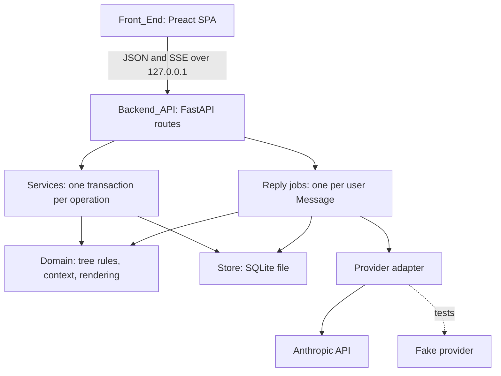

# Design Document

> **Status: v2, implemented 12 Oct 2026 (branch `message-tree`).** Replaces the v1 design. The model is now a plain tree of immutable
> Messages; v1's Branch records, framing, Notes, Status and merging are gone. v1 is in git history.

## Overview

Tree Chat is a single local process: a Python HTTP server (Backend_API) that owns a SQLite file (Store)
and calls one LLM provider. It also serves a small TypeScript single-page Front_End. The browser talks to
the server over JSON and server-sent events; nothing is exposed beyond `127.0.0.1`.

The core is pure logic in `treechat/domain/`:

1. **Tree rules**: the shape of a Message tree, Paths, and how Branches are derived from it.
2. **Context**: the Context_Manifest of a Reply is the Path to its user Message.
3. **Rendering**: turn a manifest into the exact provider request, byte for byte.

### Key Design Decisions

| Decision | Choice | Rationale |
|---|---|---|
| Model | **A tree of immutable Messages. Each Message stores its parent. Branches are derived, not stored.** | Owner, 12 Oct 2026: the only actions are "navigate to an ancestor" and "create a new child". A Message tree says exactly that and nothing more. v1's Branch records (anchor, fork point, framing, status) existed for tangents, parking and merging, which are now out of scope. |
| Alternating roles | **user → assistant → user …; a user Message has at most one Reply; branching happens only below assistant Messages.** | A Reply is generated, not chosen, and there is no regenerate (Req 5.2). So the only place a choice exists is "what to ask next", which is a child of an assistant Message. It also keeps every Path a valid provider conversation. |
| Context | **The Path, nothing else: no framing, no notes, no summaries.** | "What the model sees is the conversation on screen." Determinism and prompt caching come for free: every Context is a prefix-extension of its parent Reply's Context. (Req 4) |
| Thinking replay | **Store each Reply's full provider content, including signed thinking blocks, and replay it unchanged; replay thinking only when the Reply's recorded model equals the requested model.** | Carried over from v1. A Reply's Path never changes (Req 5), so replaying its thinking is always valid. A refusal fallback may answer with another model, whose thinking belongs to that model. |
| Prompt caching | **One cache breakpoint on the last block before the new user Message; top-level automatic caching for the rest. The system prompt is frozen and versioned.** | Sibling branches from the same point share their whole prefix, so a new branch reads it from the cache. Latency, not cost. (Req 4.3) |
| Forest | **All Trees form a forest; each Tree has exactly one Root, the first Message typed. A Tree is created by sending its first Message.** | Owner, 12 Oct 2026. A second opening question is a new Tree, so there is no empty start node and no exception to role alternation; the Trees menu is the forest. (Req 1.1, 5.3) |
| Branches for the graph | **The Root's Branch is the graph's root node. A Branch starts at the Root (or at each child of a Fork) and runs down through single children to the next Fork or Leaf. Computed in one pass in the domain; ordered among siblings by creation time.** | Matches what the eye sees as a "line of conversation". Deriving them means nothing can drift out of sync with the Messages. (Req 6) |
| Graph | **Kept from the v1 UI review: SVG node-link diagram, depth left to right, the neighbourhood of the current Branch drawn, other subtrees collapsed into counted nodes; pan, zoom, fit, `M` to enlarge. Pure TypeScript for visibility and layout.** | Owner chose to keep it, 12 Oct 2026. Its layout and visibility logic are already property-tested and carry over with small changes (nodes are derived Branches; no Status). |
| Current_Point in the address | **`#/t/<tree>/m/<message>`, or `#/t/<tree>` for the Tree's default.** | Back and forward work; a point can be bookmarked. |
| Replies, jobs, streaming | **Kept from v1: one asyncio job per user Message, independent of the HTTP request; SSE stream with catch-up for late subscribers.** | Closing the tab must not lose a paid reply (Req 3.8). The registry keys change from Branch to user Message. |
| Store | **SQLite, WAL, one file, triggers enforce immutability and shape. New schema in a new default file (`data/tree_chat_v2.sqlite3`).** | v1 Stores hold only fake-provider test data (live tests were never run), so there is nothing to convert. A new file avoids opening a v1 Store with the v2 schema. (Req 7) |
| Provider | **Kept from v1: Anthropic, `claude-opus-5-5`, adaptive thinking, effort `high`, streaming, server-side fallback; the model that produced a Reply is recorded on it. The Fake provider rejects any request the real API would reject.** | Unchanged requirements; this layer is model-agnostic. (Req 8) |
| Stack | **Python 3.14, FastAPI, uvicorn, SQLite; Preact, TypeScript, signals, Vite; pytest, Hypothesis, Vitest, fast-check.** | Unchanged from v1 (see tech.md). |
| Network exposure | **Bind `127.0.0.1` only; no authentication.** | Single user, local. Known limit: any local process can call the API. |

### What carries over from v1, and what does not

| Area | v2 |
|---|---|
| `provider/` (Anthropic adapter, Fake with API-rule checks) | Kept as is. |
| `domain/render.py` | Kept; its input becomes a list of Messages (no framing or note entries). The system prompt is rewritten (new version number) to drop tangent and note wording. |
| `jobs/registry.py`, `jobs/replies.py` (reply part), SSE in `api/` | Kept; keyed by user Message. Generated-text jobs are dropped. |
| `store/db.py` (connections, transactions, migrations) | Kept. The migration scripts start again at `001` for the new schema. |
| `api/app.py`, `api/state.py`, error mapping | Kept. Routes are rewritten. |
| Front end: markdown renderer, SSE parser, API client pattern, graph layout and pan/zoom, composer, manifest dialog | Kept and adapted. |
| Branch records, anchors, framing, Notes, Status machine, closings, merge, queue, generated text, passage selection, markers | Removed. |

## Architecture



Layers are as in v1: `domain/` pure (no I/O, clock or ids), `store/` the only SQLite code, `services/` one
transaction per operation, `jobs/` the only provider callers, `api/` shapes only.

### Request flow: send and reply

1. `POST /api/trees {content}` creates the Tree and its Root (Req 1.1); `POST /api/trees/{tree_id}/messages {parent_id, content}` sends from the Current_Point, an assistant Message of the Tree. The service validates content (Req 3.9) and the parent (Req 3.2), inserts the user Message and returns 201 with it.
2. `POST /api/messages/{user_message_id}/reply`: checks the user Message has no Reply and no running job (Req 3.7), assembles the manifest from its Path (Req 4.1), renders the request, registers a job and streams SSE.
3. On completion (or `max_tokens`) the job inserts the Reply with its content blocks, manifest, model and stop reason, then emits `done`. On failure it persists nothing and emits `error` (Req 3.5).
4. `GET /api/messages/{user_message_id}/live` re-attaches to a running job (204 if none) (Req 3.8).

## API Contract

| Method | Path | Purpose | Req |
|---|---|---|---|
| `GET` | `/api/health` | Readiness; whether credentials are present (never their value) | 8.3 |
| `GET` | `/api/trees` | Trees, most recently active first | 1.2 |
| `POST` | `/api/trees` | Create a Tree with its Root: `{content}` → `{tree, message}` | 1.1, 1.3 |
| `PATCH` | `/api/trees/{id}` | Rename | 1.3–1.4 |
| `GET` | `/api/trees/{id}` | The Tree's shape: every Message without content (id, parent, role, created_at, label = first 60 characters for user Messages), the derived Branches, and the default Current_Point | 2.2, 6 |
| `GET` | `/api/messages/{id}/path` | The Path to a Message with full content; for each Message its child count; `awaiting_reply`, `reply_in_progress`, and `latest_below` (the most recent Reply below the last Message, for "jump to the latest") | 2.1, 2.4, 3.10 |
| `POST` | `/api/trees/{id}/messages` | Send: `{parent_id, content}`; `parent_id` is an assistant Message of the Tree | 3.1–3.2, 3.9 |
| `POST` | `/api/messages/{id}/reply` | Generate the Reply to a user Message (SSE) | 3.3–3.7 |
| `GET` | `/api/messages/{id}/live` | Re-attach to a Reply in progress (SSE; 204 if none) | 3.8 |
| `GET` | `/api/messages/{id}/manifest` | Context_Manifest of a Reply | 4.4–4.5 |

SSE events: `started`, `delta {text}`, `done {message}`, `error {error, message}`; one JSON object per `data:` line.

Errors: `{error, fields, message}`. Categories: `validation` 422, `not_found` 404, `conflict` 409, `busy` 409,
`context_too_large` 422, `provider_unavailable` 503, `provider_error` 502, `refused` 502. After an SSE stream
has started, errors arrive as `error` events.

## Data Model

```sql
trees(id TEXT PRIMARY KEY, title TEXT NULL, created_at TEXT, last_activity_at TEXT)

messages(
  id TEXT PRIMARY KEY, tree_id TEXT REFERENCES trees, parent_id TEXT NULL REFERENCES messages,
  role TEXT CHECK (role IN ('user','assistant')), content TEXT,
  provider_blocks TEXT NULL, model TEXT NULL, stop_reason TEXT NULL, manifest TEXT NULL,  -- assistant only
  created_at TEXT
)
```

Enforced by triggers (Req 5): no UPDATE or DELETE of messages, no DELETE of trees; exactly one parentless
Message per Tree, and it is a user Message (the Root); every other user Message's parent is an assistant
Message of the same Tree; an assistant Message's parent is a user Message of the
same Tree with no other assistant child; an assistant Message carries its blocks, model and manifest.
Ids are UUIDv7; times are UTC ISO-8601. Each operation is one `BEGIN IMMEDIATE` transaction (Req 7.3).

## Domain logic (pure)

```python
path(tree: TreeSnapshot, message_id) -> tuple[MessageId, ...]              # Req 2.1, 4.1
check_parent(tree, parent_id) -> None | Conflict                           # Req 3.2, 5.3
assemble(tree, user_message_id, settings) -> Manifest                      # Req 4.1, 4.4
render(manifest, messages, system) -> ProviderRequest                      # Req 4.2-4.3 (kept from v1)
branches(tree) -> tuple[BranchInfo, ...]                                   # Req 6: derived runs, one pass
default_point(tree) -> MessageId | None                                    # Req 2.2
```

Front end (pure TypeScript, `web/src/graph/`): `visibleGraph` and `layoutGraph`, kept from v1 and fed with
derived Branches.

## Correctness Properties

1. **Immutability.** *For any* sequence of operations, every Message and manifest persisted at step *i* is byte-identical at every later step. (Req 5.1)
2. **Shape.** *For any* sequence of operations, each Tree is one tree under its Root with alternating roles, at most one Reply per user Message, and parents in the same Tree. (Req 5.3)
3. **Context is the Path.** *For any* Reply, its manifest lists exactly the Path to its user Message, in order. (Req 4.1)
4. **Determinism and shared prefixes.** Rendering the same manifest twice gives identical bytes, and two Replies whose Paths share a prefix have byte-identical requests through it. (Req 4.2–4.3)
5. **Thinking replay is valid.** Every replayed assistant turn is byte-identical to how it was stored, and the request bytes before it equal the request that produced it. (Req 4.2, 5.1)
6. **Failed operations leave no trace.** A rejected send or a failed reply leaves the Store unchanged apart from the user Message already committed. (Req 3.5, 7.3)
7. **Branches partition the Tree.** Every Message is in exactly one derived Branch; a Branch is a chain; Branches change only by gaining Messages or splitting at a new Fork. (Req 6)
8. **Graph** (kept from v1 Properties 17–19): every Branch is drawn or counted exactly once; the neighbourhood of the current Branch is always drawn; depth runs left to right without overlap. (Req 6.1–6.4)

## Testing Strategy

- **Zero AI credits by default** (Req 8.5): the Fake provider, and a fixture that blocks non-loopback connections. `pytest -m live` only with the owner's go-ahead.
- **Hypothesis** for Properties 1–7, including a stateful machine whose rules are: create a Tree, create a Tree with its Root, send from a random point (any assistant Message), request a Reply with a random Fake outcome (ok, fail, refuse, truncate, fallback, too large), and send from an invalid point. Every new rule test is shown to fail when the rule is broken on purpose.
- **Integration tests** with FastAPI's client on a temporary Store: send, reply, SSE, `busy`, disconnect then `live`, validation field names, triggers rejecting UPDATE/DELETE and bad shapes.
- **Front end**: Vitest and fast-check for the graph properties, the Path view, the composer and navigation.
- **Manual**: readability and frame rate with a seeded 500-Branch Tree on the Fake provider (Req 6.11), from `scripts/seed_synthetic.py`.

## Open questions

None. Answered by the owner on 12 Oct 2026, all as recommended:

1. Superseded the same day by the owner's forest decision: each Tree has exactly one Root, the first Message typed; a different opening question is a new Tree.
2. Opening a Tree goes to the most recently created Reply.
3. Clicking a graph node goes to the last Message of that Branch.
4. v1 Stores are left alone; v2 uses a new file.
