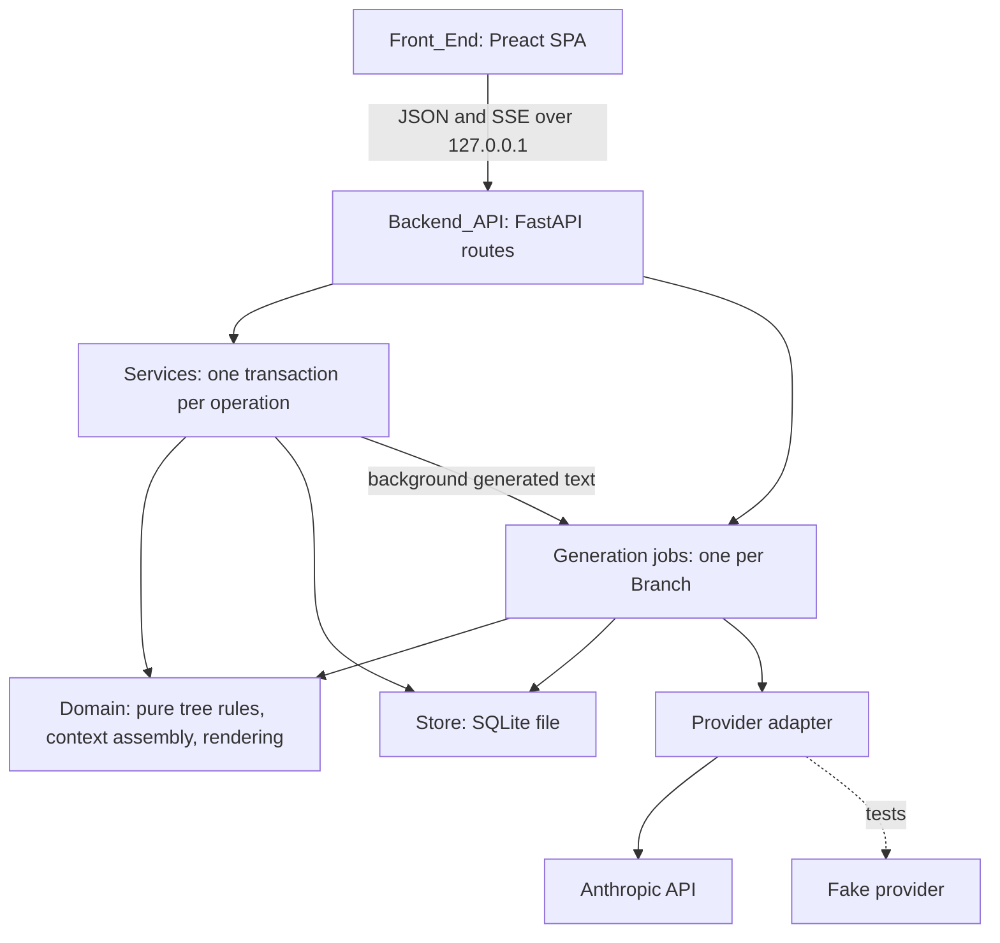

# Design Document

<!--
What this file is for: HOW the requirements are met, and WHY each choice was made, so a later
change can tell what is safe to alter.

Habits that kept this file useful:
- Every non-obvious choice is a row in the decisions table, with its reason. Put the owner's
  decisions in as "owner's decision, <date>" so they are not re-litigated.
- When a decision is superseded, REPLACE the row (say "superseding ..."), do not leave both.
- State consequences and known limits in the row that causes them, in bold ("Consequence:",
  "Known limit:"), including ones the owner accepted.
- Cite requirement numbers, e.g. (Req 12.4), so every criterion can be traced to a design
  choice and back.
- Describe the contract (inputs, outputs, errors) exactly enough that the front and back ends,
  and the tests, can be written from it.
- After every change, search this file for the old wording of anything you changed.
-->

> **Status: approved by the owner, 11 Oct 2026.** Rows that were proposals are now marked "owner accepted, 11 Oct 2026".

## Overview

Tree Chat is a single local process: a Python HTTP server (Backend_API) that owns a SQLite file
(Store) and calls one LLM provider. The process also serves a small TypeScript single-page
Front_End. The browser talks to the server over JSON and server-sent events, and nothing is
exposed beyond `127.0.0.1`.

**The core is pure logic in `treechat/domain/`.** It covers three things:

1. **Tree rules**: strict tree, linear chains, Fork_Point placement, the Status machine and merge targets.
2. **Context assembly**: from a snapshot of a Tree, compute the Context_Manifest for the next reply.
3. **Rendering**: turn a manifest into the exact provider request, byte for byte.

Everything that carries the product's promise lives there, with no I/O. That is where the
property-based tests point.

Around the core:

- **Services** run each user operation as one Store transaction.
- **Generation jobs** stream replies independently of the browser connection.
- **The provider adapter** is Anthropic in use, and a deterministic Fake in tests.

### Key Design Decisions

| Decision | Choice | Rationale |
|---|---|---|
| v1 boundary | **One user, local, one provider, many Trees. No sign-in, sync, mobile, multi-anchor, summary mode, pinning or deletion.** | Owner's decision, confirmed 11 Oct 2026. Deletion is added to the out-list (owner accepted, 11 Oct 2026), because immutability makes it a design question of its own (Req 16.3). |
| Shape | **Strict tree of Branches; one Anchor per Branch; Messages immutable; no depth cap** | Owner's decision (handover). Enforced in the Store by triggers and in the domain by validation (Req 3.1, 6). |
| Spawning | **Select text → popover with focused one-line Intent; Enter = park, Ctrl/Cmd+Enter = open; spawning never navigates unless opened** | Owner's decision (handover) (Req 4.1–4.2). |
| Anchor vs Fork_Point | **Separate fields. Fork_Point defaults to the Anchor's Message; option: the parent's Tip** | Owner's decision (handover) (Req 4.8, 9). Added (owner accepted, 11 Oct 2026): the Fork_Point stays changeable until the Branch's first Message, so a Tangent parked for a week can catch up when resumed (Req 9.2, 10.6). |
| Parent of a Tangent | **The Branch that owns the Anchor's Message, not the Branch being viewed** | A selection in the inherited part of a Path_View is about that earlier Message. Making the viewer the parent would give the new Branch knowledge (the viewer's framing and Messages) that its Fork_Point says it lacks, which contradicts the Fork_Point. (Req 4.4) |
| Context modes | **One: every Branch inherits. *Superseding* the handover's Inherit/Clean modes and the mid-branch switch.** | Owner's decision, 11 Oct 2026. **Consequence:** a Branch's Contexts only ever grow, which makes the prompt cache and thinking replay simple (rows below). Req 7.2, 8 and 14.5 are retired. |
| What inheriting means | **"What the parent knew at the Fork_Point": the parent's own Context through the Fork_Point, including the parent's Inherited_Prefix and Framing_Block. *Superseding* the handover's "full path root → fork point".** | Owner accepted, 11 Oct 2026. (1) The literal path drops every ancestor's Framing_Block, so a grandchild sees messages about a tangent without being told it was one. (2) The literal path is not a prefix of any request already sent, so it never hits the prefix cache. The recursive reading fixes both. **It equals the literal path plus the ancestors' Framing_Blocks.** (Req 7.1, glossary) |
| Storing the Inherited_Prefix | **Not stored; derived from the parent's chain each time** | With one mode it depends only on immutable things: the parent's own (already fixed) prefix, its frozen framing and its Messages up to the Fork_Point. Storing it would duplicate data that cannot drift. The Fork_Point is the only input that can move, and only before the first Message (Req 9.2), so the prefix is fixed from then on (Req 7.6). |
| Framing_Block placement | **A `role: "system"` message placed immediately after the Branch's first user Message. *Superseding* the handover's "before the branch's first message".** | Owner accepted, 11 Oct 2026. The framing is an operator instruction, and the provider has a channel for exactly that: mid-conversation system messages on Opus 5.5. That channel only accepts a system message after a user turn, so "before the first message" would mean faking it as user text. The model still reads the framing before it writes anything in the Branch. **Consequence:** the abstract manifest order is `[prefix…, first user Message, Framing_Block, …]`. The provider only accepts a system message after a user turn and before an assistant turn (or last), so a Branch whose Tip is an unanswered user Message accepts no further user Message or merge Note (Req 2.9, 13.5). An Alternative of a Tangent's first Message keeps that Tangent's framing in the same place (Req 3.5). The cache breakpoint cannot sit on a system message, so when the inherited prefix ends in a Framing_Block it moves to the nearest earlier Message block. (Req 7.1) |
| Framing contents | **Anchor quote, the user's Intent if written, the stay-on-tangent instruction. Frozen at first Message. Never a Generated_Intent.** | A model-guessed intent must not steer the model. Freezing keeps the Branch's history byte-stable; editing the Intent afterwards changes only the label. (Req 7.3, 11.5) |
| Edits and regenerations | **Become an *Alternative*, a second kind of Branch: whole-Message Anchor, Fork_Point = the predecessor, always inherits, no Framing_Block** | Owner accepted, 11 Oct 2026. "Editing forks a visible sibling" (owner) needs somewhere to live. Making it a Branch keeps a single tree and a single navigation model. Using the Tangent machinery unchanged would wrap a plain retry in a "stay on the tangent" frame, which is wrong. Here Anchor and Fork_Point differ (the Anchor is the replaced Message, the Fork_Point its predecessor), which the separate fields already allow. (Req 3) |
| Status semantics | **`open` = in progress. Several may be open. Viewing never changes Status. Sending in a `parked` Branch opens it.** | Owner accepted, 11 Oct 2026. The handover leaves "open" undefined. If it meant "the one on screen", it would be navigation state, and parking would happen by accident every time you looked elsewhere. (Req 10.1, 10.3, 10.8) |
| Thinking blocks across requests | **Store each reply's full provider content, including signed thinking blocks, and always replay it unchanged** | On Opus 5.5 a thinking block is bound to the exact prefix that produced it. Accounts created on or after 31 Aug 2026 get a hard 400 if a block is replayed after its prefix changed. With one mode and append-only history, a reply's prefix never changes, so replay is always valid. This is an invariant the tests prove (Property 7), not a run-time check. It is also why nothing may ever be edited, reordered or re-rendered differently in a Context. |
| Notes in the provider request | **Rendered as a labelled text block in a user turn (`<tree_chat_note …>`), merged with any adjacent user content. The frozen system prompt explains what Notes are.** | A Note usually lands after an assistant turn, where the provider does not accept a system message. Labelling stops the model treating the Note as something the user said (Req 7.9). |
| Merge semantics | **Close and Merge are one transaction: record the closing, append one Note at the target's Tip, change Status. Targets are non-closed ancestors; the default is the parent.** | Owner's decision that merge appends and never rewrites (handover). Target scope and the conclusion rules: owner accepted, 11 Oct 2026 (Req 12, 13). Ancestors only, so information flows along the tree and never across it. "Non-closed" ensures the Note lands somewhere it will be read. |
| Reach of a Note | **A Note reaches later replies in its target, and Branches whose Fork_Point is the Note or later.** **Known limit:** with the default Fork_Point (the Anchor), a new Tangent anchored on any passage *above* the Note will not see it. | Follows from append-only merges plus Anchor-based Fork_Points. *Pushback:* the owner's "only branches forked after a merge inherit its note" understates this. Timing is not enough; the Fork_Point must be at or after the Note. The tip-fork option (Req 9) is the way to bring Notes along. See Open question 6. |
| Conclusions | **Required for `merged` and `kept`, optional for `abandoned`. The close panel arrives pre-filled with a model draft.** | Owner accepted, 11 Oct 2026. Requiring a Conclusion is what makes closing count. Pre-filling it makes the requirement cheap, so closing stays easier than drifting. `abandoned` stays frictionless, so dead ends get closed rather than left open. (Req 12.1–12.2) |
| Generated text | **Generated_Intent at spawn when no Intent is given, from the Anchor and its Message only. A "where it stands" line when a Branch with replies is parked. Conclusion drafts on request. None ever enters a Context.** | *Pushback on the handover:* "auto-summary when the intent was skipped" has nothing to summarise for a freshly parked Tangent, which has no Messages. So it is generated *from the Anchor* at spawn. The summary of progress is a separate thing, made at park time. (Req 11) |
| Visualisation | **Three views: the Path_View for reading, the Outline (sidebar) for keyboard navigation, and a Tree_Map with semantic zoom for the overview. *Superseding* "no node-and-edge graph".** | Owner's request, 11 Oct 2026: see the whole tree and where you are, from a few macro-branches down to individual messages. My earlier objection was to a graph that draws every Message at once. Semantic zoom answers it, because detail appears only when it has room to be read. The Outline stays, because it is the keyboard and screen-reader route and costs little. (Req 14) |
| Tree_Map layout | **Tracks: x = Conversation_Position, one horizontal Track per Branch; a child Track starts under its parent at its Anchor's x; rows in depth-first order.** | It answers "where am I in the conversation" as well as "where am I in the tree": the Trunk reads left to right like the chat itself, and a tangent visibly leaves at the passage it is about. Messages become ticks on Tracks, which gives the "actual leaves" level for free. A conventional node-link tree (one dot per Branch) was rejected because it has no natural place for Messages and loses where along the parent a tangent left. **Known limit:** adding a Branch inserts rows, so Tracks below it move down. Their order never changes. |
| Level of detail | **Collapse by on-screen size, not by depth: a subtree whose expanded box would be under 24 px tall (or whose Tracks would be under 6 px apart) on screen is drawn as one Macro_Branch. The path to the current Branch is always expanded.** | Depth-based levels fail on lopsided trees: one deep rabbit hole and twenty shallow tangents need different treatment. Size-based collapse is how maps show cities as you zoom. It is monotone in zoom by construction, so there is no flicker (Req 14.18). The "you are here" path is exempt, so the current position is visible at every zoom (Req 14.13). |
| Tree_Map rendering | **SVG drawn by Preact. The pan/zoom transform is our own (pointer, wheel and keys). Only what is in the viewport is drawn. Layout and level of detail are pure TypeScript functions.** | 500 Tracks plus visible ticks is well within SVG's comfort. Culling to the viewport keeps 10,000 Messages cheap (Req 14.17). Pure functions make the rules property-testable. **Risk:** if SVG misses 30 fps on the owner's machine, the drawing layer moves to Canvas; layout and level of detail are unaffected. |
| Rabbit-hole cues | **Depth and open/parked counts always visible; one-key Close; optional reply-count nudge (default 8)** | Owner accepted, 11 Oct 2026. These are cheap, constant and non-blocking. Hard limits (depth caps, maximum open Branches) were rejected: the owner wants no depth cap, and hard limits push people towards workarounds. (Req 15) |
| Backend language | **Python 3.14.** F# was the close second; Haskell was rejected. | Owner accepted, 11 Oct 2026. An honest comparison: **F#** gives discriminated unions and exhaustive matching, which suit the Status machine and manifest entries well, and FsCheck works. Against it: no .NET toolchain is installed here, and SSE streaming and markdown support are thinner. **Haskell** gives the strongest types, but has no official Anthropic SDK and the slowest iteration; the domain is not hard enough to repay that. **Python** has the provider's first-party SDK, where features land first (thinking blocks, fallbacks, caching). It also has **Hypothesis stateful testing**, which matches this product's riskiest part (sequences of spawn/park/close/merge/switch) better than anything in the other two. Frozen dataclasses, `match`/`assert_never` and pyright strict cover most of what F# would add. **TypeScript end to end** was also weighed (shared types with the Front_End). It lost on property-testing depth. |
| Web layer | **FastAPI on uvicorn; replies streamed as `text/event-stream`** | Pydantic gives the field-named validation errors the requirements ask for. SSE is one-directional and enough for streaming; WebSockets add nothing here. |
| Generation jobs | **One in-process asyncio task per reply, independent of the HTTP request. Streams fan out to subscribers. At most one job per Branch.** | Req 2.5–2.6: closing the tab must not lose a paid reply. A single process means an in-memory registry is enough. **Known limit:** a reply in progress when the server stops is lost, and the user Message remains as the Tip so it can be retried. |
| Store | **SQLite (stdlib `sqlite3`), WAL mode, one file. Triggers forbid UPDATE/DELETE on `messages`. Schema migrations keyed on `PRAGMA user_version`.** | Single user, local, relational shape, transactional merges (Req 13.1, 16.5). Enforcing immutability in the database means a bug cannot quietly rewrite history (Req 3.1). |
| Identifiers | **UUIDv7 strings (`uuid.uuid7()`, Python 3.14)** | Time-ordered (gives stable ordering) and safe to generate anywhere. |
| Anchor offsets | **Unicode code points into the Message's stored source text (markdown). The server checks `content[start:end] == quoted_text`.** | The server can verify anchors without a renderer (Req 4.5). The Front_End converts from its UTF-16 offsets. **Known limit:** a selection across formatting stores the markdown source, e.g. `**`, in `quoted_text`. **Risk:** mapping a selection in rendered markdown back to source offsets is the least certain piece. It is built first, as a spike (see Testing). |
| Front_End | **TypeScript + Preact + Vite; `@preact/signals` for state; markdown parsed to mdast (micromark) and rendered by our own component so source positions survive** | Lightweight, which the owner asked for, and nothing in v1 needs a heavier framework. Our own renderer is needed anyway to tag text with source offsets for anchoring. |
| Provider | **Anthropic, `claude-opus-5-5`, adaptive thinking, effort `high`, streaming, server-side fallback `"default"` (beta `server-side-fallback-2026-07-01`). The model that actually produced a reply is recorded on that reply; the manifest records the model requested.** | Owner accepted, 11 Oct 2026. The owner left this open. Cost is not a constraint, so effort is `high` rather than Opus 5.5's default `medium`. Fallback keeps a refused request answerable. The recorded model drives the thinking-replay check. |
| Replaying a reply written by another model | **Thinking blocks are replayed only when the reply's recorded `model` equals the requested model; otherwise only its visible text is sent.** Each stored reply records the model that actually produced it. | A refusal fallback serves a reply with a different model, whose signed thinking belongs to that model. This is a refinement of the previous row, decided while building the provider. **Consequence:** changing `TREECHAT_MODEL` also stops earlier thinking being replayed, which invalidates the prompt cache once. |
| Framing that precedes a user turn | **A Framing_Block is sent as a mid-conversation `system` message only when it is last or followed by an assistant turn; otherwise it is sent as a labelled user text block in the same user turn.** | Happens when a Tangent is forked from a user Message that has no reply yet. The provider rejects a system message followed by a user turn. Decided while building the renderer. (Req 7.1) |
| Prompt caching | **Breakpoint 1 on the last block of the Inherited_Prefix; breakpoint 2 via top-level automatic caching. The system prompt is frozen and versioned.** | Sibling Tangents share breakpoint 1 byte for byte (Req 7.5). The Branch's own growing tail uses breakpoint 2. This is about latency, not cost. |
| Network exposure | **Bind `127.0.0.1` only; no authentication** | Single user, local (Req scope). **Known limit:** any process on the machine can call the API. Acceptable for v1; revisit if it is ever hosted. |
| Tasks document | **None. Implementation steps go to plan mode for approval.** | Owner's decision, 11 Oct 2026: CLAUDE.md wins over the handover's "tasks document". |

## Architecture



### Layered Responsibilities

1. **Domain** (`treechat/domain/`): pure functions over immutable snapshots. It covers validation, the Status machine, context assembly and provider rendering. It must never do I/O, read the clock or generate ids; those are passed in.
2. **Store** (`treechat/store/`): the only code that touches SQLite. It loads snapshots and writes rows inside a transaction it is given, and it holds the migrations. It makes no decisions.
3. **Services** (`treechat/services/`): one function per user operation. Each opens a transaction, loads a snapshot, asks the domain, then writes or rolls back. Services never call the provider directly; they enqueue jobs.
4. **Jobs** (`treechat/jobs/`): reply generation, Generated_Intent, "where it stands" and Conclusion drafts. A job owns its provider call and its event stream. It persists only on success.
5. **Provider** (`treechat/provider/`): turns a rendered request into a streamed provider call and back. The Anthropic and Fake implementations share one interface. Credentials are read here and nowhere else.
6. **API** (`treechat/api/`): HTTP shapes, validation errors and SSE framing. No business rules.
7. **Front_End** (`web/`): display and input. Its limits are conveniences; the Backend_API re-checks everything.

### Request Flow: send a Message and receive a reply

1. `POST /api/branches/{id}/messages {content}`
   - Service validates content (Req 2.7) and checks Status (`closed` → `conflict`; `parked` → becomes `open`, Req 2.8) and checks the Branch has no job (`busy`, Req 2.5).
   - If this is the Branch's first Message, it fixes the Framing_Block, and from then on the Fork_Point cannot move (Req 7.3, 7.6, 9.2).
   - It inserts the user Message as the new Tip, all in one transaction, and returns `201` with the Message.
2. `POST /api/branches/{id}/reply` (an empty body)
   - Service checks that the Tip is a user Message and that no job is running.
   - It loads a snapshot. The domain assembles the manifest (Req 7.1) and renders the provider request (Req 7.4).
   - A job is registered for the Branch, and the response becomes an SSE stream subscribed to it.
3. The job streams from the provider and forwards `delta` events. On normal completion, or `max_tokens`, it inserts the assistant Message with its full content blocks, its manifest and its stop reason in one transaction. It then emits `done` with the Message.
4. Failure branches:
   - The provider errors, or the final result is a refusal: nothing is persisted, `error {category}` is emitted, and the user Message stays as the Tip (Req 2.3). A provider rejection for prompt length is reported as `context_too_large` (Req 7.10). With a 1M-token window this is rare, so the app does not count tokens in advance.
   - The browser disconnects: the job carries on, and `GET /api/branches/{id}/live` re-subscribes, replaying text already received (Req 2.6).
   - The server stops mid-job: the reply is lost and the Tip stays a user Message.

## Components and Interfaces

### API Contract

All paths are under `http://127.0.0.1:<port>`.

| Method | Path | Purpose | Requirements |
|---|---|---|---|
| `GET` | `/api/health` | Readiness probe for the launch shortcut; reports whether provider credentials are present (never their value) | 17.3 |
| `GET` | `/api/trees` | List Trees with counts | 1.2 |
| `POST` | `/api/trees` | Create Tree with Trunk | 1.1, 1.4 |
| `PATCH` | `/api/trees/{tree_id}` | Rename | 1.3, 1.4 |
| `GET` | `/api/trees/{tree_id}` | Tree with all Branch summaries (Outline data) | 14.1–14.2 |
| `GET` | `/api/trees/{tree_id}/map` | Everything the Tree_Map needs: per Branch its parent, Anchor position, start position, message count, Status, Intent; per Message its role and position (no content) | 14.8–14.18 |
| `GET` | `/api/messages/{message_id}/preview` | First 200 characters of a Message, for Tree_Map hover | 14.14 |
| `GET` | `/api/trees/{tree_id}/queue?order=oldest\|newest\|parent` | Parked Branches with staleness facts | 10.2, 10.4–10.5 |
| `GET` | `/api/branches/{branch_id}/view` | Path_View: inherited entries, framing, own Messages, markers | 5, 14.4 |
| `POST` | `/api/branches` | Spawn a Tangent | 4, 9.1 |
| `PATCH` | `/api/branches/{branch_id}` | Change `intent` or `fork_at` | 9.2–9.3, 11.4 |
| `POST` | `/api/branches/{branch_id}/messages` | Append a user Message | 2.1, 2.5, 2.7–2.8 |
| `POST` | `/api/branches/{branch_id}/reply` | Generate a reply to the Tip (SSE) | 2.2–2.5, 7 |
| `GET` | `/api/branches/{branch_id}/live` | Re-attach to a reply in progress (SSE; 204 if none) | 2.6 |
| `POST` | `/api/messages/{message_id}/alternatives` | Edit (user Message, `content` required) or regenerate (assistant Message, no body) | 3.2–3.3 |
| `POST` | `/api/branches/{branch_id}/park` | `open` → `parked` | 10.1, 11.2 |
| `POST` | `/api/branches/{branch_id}/resume` | `parked` → `open` | 10.1, 10.3 |
| `POST` | `/api/branches/{branch_id}/conclusion-draft` | Model-drafted Conclusion (not stored) | 12.1 |
| `POST` | `/api/branches/{branch_id}/close` | Close, optionally merge, optionally abandon descendants | 12, 13 |
| `POST` | `/api/branches/{branch_id}/reopen` | `closed` → `open` | 12.7 |
| `GET` | `/api/messages/{message_id}/manifest` | Context_Manifest of an assistant Message | 7.7–7.8 |

#### Request and response bodies

Spawn a Tangent:

```json
{
  "parent_branch_id": null,
  "anchor": { "message_id": "0192…", "start": 120, "end": 188, "quoted_text": "prefix caching only helps if…" },
  "intent": "Does this hold for Anthropic's cache too?",
  "fork_at": "anchor",
  "status": "parked"
}
```

- `parent_branch_id`: ignored. The parent is derived from `anchor.message_id` (Req 4.4); the field is accepted only so the Front_End can state what it expected. A mismatch is not an error.
- `anchor.start` and `anchor.end`: integers, code points, with `0 ≤ start < end ≤ len(content)`. `quoted_text` must equal the slice (Req 4.5).
- `intent`: string of at most 200 characters after trimming. Omitted or empty means none, and a Generated_Intent is made (Req 4.3, 11.1).
- `fork_at`: `"anchor"` (the default) or `"tip"`.
- `status`: `"parked"` (the default) or `"open"`.

Response `201` is a Branch summary:

```json
{
  "id": "0192…", "tree_id": "0192…", "parent_branch_id": "0192…", "kind": "tangent",
  "anchor": { "message_id": "…", "start": 120, "end": 188, "quoted_text": "…" },
  "fork_point_message_id": "…", "intent": "…", "generated_intent": null,
  "status": "parked", "depth": 2, "message_count": 0,
  "parked_at": "2026-10-11T09:14:03Z", "parent_messages_since_fork": 0,
  "closings": []
}
```

Close:

```json
{ "outcome": "merged", "conclusion": "Yes: the cache is keyed on exact prefix bytes…", "merge_target": "0192…", "abandon_descendants": false }
```

- `outcome`: `"merged"`, `"kept"` or `"abandoned"`.
- `conclusion`: required and non-empty for `merged` and `kept`; at most 2,000 characters (Req 12.2–12.3).
- `merge_target`: for `merged` only. Defaults to the parent. It must be a non-closed ancestor (Req 13.3–13.4).
- `abandon_descendants`: when true, every non-closed descendant is closed as `abandoned` in the same transaction (Req 12.6).

The response is the Branch summary plus `note_message_id` when a Note was written.

SSE events from `/reply` and `/live`, one JSON object per `data:` line:

- `{"type":"started","job_id":"…"}`
- `{"type":"delta","text":"…"}`: visible text only. Thinking is not streamed to the screen in v1.
- `{"type":"done","message":{…assistant Message…}}`
- `{"type":"error","error":"provider_error|refused|provider_unavailable|context_too_large","message":"…"}`

Context_Manifest (`GET /api/messages/{id}/manifest`):

```json
{
  "system_prompt_version": 1,
  "model": "claude-opus-5-5",
  "settings": { "effort": "high", "max_tokens": 64000 },
  "entries": [
    { "kind": "message", "id": "…", "role": "user" },
    { "kind": "message", "id": "…", "role": "assistant" },
    { "kind": "framing", "branch_id": "…", "text": "…" },
    { "kind": "message", "id": "…", "role": "note" }
  ],
  "cache_breakpoint_after": 7
}
```

- `cache_breakpoint_after`: the index of the entry that carries breakpoint 1, or null.

#### Error response body

```json
{ "error": "validation", "fields": ["anchor"], "message": "quoted_text does not match the message text at 120–188" }
```

Error categories: `validation` (422), `not_found` (404), `conflict` (409), `busy` (409), `context_too_large` (422), `provider_unavailable` (503), `provider_error` (502), `refused` (502). After an SSE stream has started, errors arrive as `error` events instead.

### Domain logic (pure functions)

```python
# treechat/domain — no I/O, no clock, no id generation.

def validate_anchor(content: str, start: int, end: int, quoted: str) -> AnchorError | None
    # Req 4.5: code-point offsets; accepted iff 0 <= start < end <= len(content) and slice == quoted.

def transition(status: Status, action: Action, kind: BranchKind) -> Status | Conflict
    # Req 10.1, 12.7–12.9: the whole Status machine; the Trunk never moves.

def merge_targets(tree: TreeShape, branch_id: BranchId) -> tuple[BranchId, ...]
    # Req 13.3: non-closed ancestors, nearest first.

def inherited_prefix(tree: TreeSnapshot, parent: BranchId, fork_point: MessageId | None) -> tuple[Entry, ...]
    # Glossary Inherited_Prefix: the parent's context entries through fork_point (recursive).

def assemble(tree: TreeSnapshot, branch: BranchId, settings: Settings) -> Manifest
    # Req 7.1, 7.3, 7.9: entries for the next reply.

def render(manifest: Manifest, contents: Mapping[MessageId, StoredMessage], system: SystemPrompt) -> ProviderRequest
    # Req 7.4–7.5: byte-deterministic; merges adjacent user-role content; places cache breakpoints.

def note_text(source: BranchSummary, conclusion: str) -> str
    # Req 13.2: the Note body (format in Data Models).

def conversation_position(message: MessageMeta, tree: TreeShape) -> int
    # Glossary Conversation_Position: messages before it on its path from the Trunk's first Message.

def staleness(branch: BranchSummary, parent_chain: Sequence[MessageMeta], now: datetime) -> Staleness
    # Req 10.5: age and parent messages since fork; facts only.
```

### Tree_Map logic (pure TypeScript, `web/src/map/`)

```ts
layoutTracks(tree: MapData): Layout
  // Req 14.9: one Track per Branch; x in Conversation_Position units, y in rows; depth-first row order;
  // siblings ordered by Anchor position then creation time. Each subtree gets a bounding box.

levelOfDetail(layout: Layout, view: Viewport, currentPath: BranchId[], minPx: MinSizes): Scene
  // Req 14.10–14.13, 14.18: chooses, for each subtree, Track or Macro_Branch; drops what is off-screen;
  // marks ticks visible only where they are at least minPx.tick apart.
```

## Data Models

The schema is described as SQLite tables. All ids are UUIDv7 text and all times are UTC ISO-8601 text.

### trees

| Field | Type | Notes |
|---|---|---|
| `id` | text pk | |
| `title` | text null | 1–200 characters; set from the first Message if null (Req 1.3) |
| `trunk_branch_id` | text | set on creation |
| `created_at`, `last_activity_at` | text | `last_activity_at` updated on every Message |

### branches

| Field | Type | Notes |
|---|---|---|
| `id`, `tree_id` | text | |
| `parent_branch_id` | text null | null only for the Trunk |
| `kind` | text | `trunk`, `tangent` or `alternative` |
| `anchor_message_id`, `anchor_start`, `anchor_end`, `anchor_quote` | | null for the Trunk; immutable |
| `fork_point_message_id` | text null | changeable only while the Branch has no Messages (Req 9.2) |
| `intent` | text null | the user's label; editable (Req 11.4) |
| `status` | text | current Status; history in `status_events` |
| `framing_text` | text null | set once at first Message, then immutable (Req 7.3) |
| `created_at` | text | |

Immutability of the once-set columns is enforced by a trigger: an UPDATE may change them from null to a value, never from a value.

### messages (append-only: UPDATE and DELETE are forbidden by trigger)

| Field | Type | Notes |
|---|---|---|
| `id`, `tree_id`, `branch_id` | text | |
| `parent_message_id` | text null | the previous Message in the chain, or the Fork_Point for a Branch's first Message |
| `seq` | int | position within the Branch, from 0; `unique(branch_id, seq)` enforces one chain (Req 6.2) |
| `role` | text | `user`, `assistant` or `note` |
| `content` | text | visible text (markdown for assistant and note); what Anchors index into |
| `provider_blocks` | json null | assistant only: full content blocks as returned, including signed thinking |
| `model`, `stop_reason` | text null | assistant only |
| `manifest` | json null | assistant only: the Context_Manifest (Req 7.7) |
| `source_branch_id` | text null | note only |
| `created_at` | text | |

### status_events, closings, generated_texts

- `status_events(id, branch_id, from_status, to_status, at)`: append-only (Req 16.4).
- `closings(id, branch_id, outcome, conclusion, merge_target_branch_id, note_message_id, closed_at)`: append-only. One row per close, so reopening keeps history (Req 12.7).
- `generated_texts(id, branch_id, kind, text, model, created_at)`: `kind` is `intent` or `standing`. Append-only; the newest row of each kind is shown (Req 11).

### Note format (owner accepted, 11 Oct 2026)

The Path_View shows the Note as a card titled "Conclusion from *<Intent, else Anchor quote>*", followed by the Conclusion and a link to the source Branch.

The provider receives it as:

```
<tree_chat_note from_branch="<Intent, else Generated_Intent, else first 80 chars of Anchor quote>" anchored_on="<Anchor quote, first 200 chars>">
<Conclusion>
</tree_chat_note>
```

`content` stores exactly this provider text, so that Anchors in a Note and the rendered request agree.

### Enforced by the database itself

`treechat/store/migrations/001_initial.sql` makes the database refuse, whatever the application does:

- any UPDATE or DELETE of Messages, Status events, closings and generated texts, and any DELETE of Trees or Branches (Req 3.1, 16.3, 16.4);
- changing a Branch's parent, kind, Anchor or creation time, changing its Framing_Block once set, and moving its Fork_Point once it has a Message (Req 7.3, 9.3);
- a Message into a closed Branch (Req 12.8), a Message that does not follow the Fork_Point or the Branch's previous Message, or a duplicate `seq` (Req 6.2);
- a second Trunk in a Tree, a parent in another Tree, or an Anchor Message that is not in the parent Branch (Req 4.4, 6.1);
- an assistant Message without its manifest, blocks and model (Req 7.7), and a closing that breaks the outcome rules (Req 12.2, 13.1).

Status changes are recorded by `repo.set_status`, which writes the event in the same transaction (Req 16.4). Each operation uses its own connection and one `BEGIN IMMEDIATE` transaction, so a failure rolls back every write of that operation (Req 16.5). A file whose `user_version` is newer than the app knows is refused rather than opened.

### Changes to an existing store

Each migration is a numbered SQL script. On start, the Store reads `PRAGMA user_version`, applies each later script in its own transaction and bumps the version. This is safe to run on every start: an up-to-date Store applies nothing (Req 16.2). Migrations only add things. A column is never dropped or reinterpreted while a released version reads it.

### Validation rules summary

| Field | Rule | Error field returned |
|---|---|---|
| `title` | 1–200 characters after trimming | `title` |
| `content` | 1–100,000 characters after trimming | `content` |
| `intent` | at most 200 characters after trimming; empty = none | `intent` |
| `anchor` | message exists in the Tree; `0 ≤ start < end ≤ len`; slice equals `quoted_text` | `anchor` |
| `fork_at` | `anchor` or `tip`; changeable only while the Branch has no Messages | `fork_point` |
| `status` (spawn) | `parked` or `open` | `status` |
| `outcome` | `merged`, `kept` or `abandoned`; `merged` not allowed for Alternatives | `outcome` |
| `conclusion` | required for `merged` and `kept`; at most 2,000 characters | `conclusion` |
| `merge_target` | non-closed ancestor of the Branch | `merge_target` |

## Correctness Properties

*A property is something that should hold for ALL valid inputs. Each is a universally quantified
statement that can be tested with a property-based test, and each names the requirements it
validates.*

### Property 1: Strict tree and linear chains

*For any* sequence of valid operations, the Branches form one tree rooted at the Trunk with no cycles. Every Branch's Messages form one chain starting after its Fork_Point, and every Fork_Point lies on the path to its parent's Tip as it stood when it was set.

**Validates: Requirements 4.4, 6.1–6.3**

### Property 2: History is never rewritten

*For any* sequence of operations, every Message, manifest, closing and once-set Branch field (framing, Anchor) persisted at step *i* is byte-identical at every later step.

**Validates: Requirements 3.1, 7.3, 7.6, 13.6**

### Property 3: Deterministic assembly and rendering

*For any* Store snapshot and settings, assembling and rendering twice produces byte-identical provider requests.

**Validates: Requirement 7.4**

### Property 4: Siblings share a byte-identical prefix

*For any* two Tangents with the same parent and Fork_Point, their rendered requests are byte-identical through the end of the Inherited_Prefix, and the cache breakpoint sits on that same block.

**Validates: Requirement 7.5**

### Property 5: Inherit means what the parent knew

*For any* Branch other than the Trunk, its Inherited_Prefix equals the entries of the parent's Context through the Fork_Point, including every ancestor's Framing_Block.

**Validates: Requirements 7.1, 7.6**

### Property 6: Contexts only grow

*For any* sequence of operations and any Branch, the Context_Manifest of each reply is a prefix of the manifest of every later reply in that Branch, and of the Context of every Branch forked at or after it. Nothing earlier is ever removed, reordered or changed.

**Validates: Requirements 7.1, 7.6**

### Property 7: Thinking replay is always valid

*For any* rendered request, every replayed assistant turn, including its thinking blocks, is byte-identical to how it was stored, and the request bytes before it are byte-identical to the request that produced it.

**Validates: Requirements 7.4, 7.6**

### Property 8: The Status machine

*For any* sequence of actions, every Branch's Status changes only along allowed transitions. The Trunk is always `open`, and a `closed` Branch never gains a Message.

**Validates: Requirements 2.8, 10.1, 12.7–12.9**

### Property 9: Merge appends exactly one Note, in the right place

*For any* successful `merged` close, the target is a non-closed ancestor and gains exactly one Message, a Note at its Tip. No other Branch's Messages change. The Note appears in a Context only for later replies in the target and for Branches whose Fork_Point is at or after it.

**Validates: Requirements 13.1, 13.3–13.4, 13.6**

### Property 10: Anchor validation is exact

*For any* string (including astral-plane characters and combining marks) and any offsets, an Anchor is accepted if and only if `0 ≤ start < end ≤ len` and the code-point slice equals `quoted_text`.

**Validates: Requirement 4.5**

### Property 11: Failed operations leave no trace

*For any* operation that fails validation or hits an injected Store fault, the Store is unchanged.

**Validates: Requirements 2.3, 16.5**

### Property 12: Generated text never reaches the model

*For any* Tree, no Context contains a Generated_Intent, "where it stands" line or Conclusion draft (other than a Conclusion the user committed as a Note).

**Validates: Requirements 7.3, 11.5**

### Property 13: Every Branch is drawn exactly once

*For any* Tree, viewport and current Branch, each Branch appears in the Scene exactly once: as its own Track, or inside exactly one Macro_Branch. Macro_Branches never nest or overlap.

**Validates: Requirements 14.10, 14.12**

### Property 14: You are always here

*For any* Tree, viewport and current Branch, every Branch on the path from the Trunk to the current Branch is drawn as its own Track, and the current Branch is marked.

**Validates: Requirement 14.13**

### Property 15: Tracks are where they belong

*For any* Tree, every Track starts at its Anchor's Conversation_Position, lies below its parent and earlier siblings' subtrees, and no two Tracks share a row segment.

**Validates: Requirement 14.9**

### Property 16: Zoom is monotone

*For any* Tree and viewport centre, and any two zoom levels k1 < k2, every subtree expanded at k1 is also expanded at k2.

**Validates: Requirements 14.11, 14.18**

## Error Handling

| Category | Status | When produced |
|---|---|---|
| `validation` | 422 | any rule in the validation table (Req 1.4, 2.7, 4.3, 4.5, 8.3, 9.3, 12.2–12.3, 13.4) |
| `not_found` | 404 | unknown Tree, Branch or Message id |
| `conflict` | 409 | disallowed Status transition; Message to a `closed` Branch; closing the Trunk (Req 10.1, 12.8–12.9) |
| `busy` | 409 | a reply is already in progress in that Branch or in the merge target (Req 2.5, 13.5) |
| `context_too_large` | 422 | the assembled request exceeds the model's input limit (Req 7.10) |
| `provider_unavailable` | 503 | no credentials, or the provider cannot be reached at all (Req 17.3) |
| `provider_error` | 502 | the provider failed after retries (Req 2.3) |
| `refused` | 502 | the final result was a refusal even after fallback (Req 2.3) |

Guarantees:

- **No partial persistence on failure.** Every service operation runs in one SQLite transaction. A close-and-merge writes the closing, the Note, the Status event and any abandoned descendants together or not at all. A reply is inserted only after the provider finishes (Req 16.5, 2.3).
- **The user's words are never lost to a provider failure.** The user Message is committed before the call (Req 2.1).
- **Credentials never appear** in the Store, logs, error messages or manifests (Req 17.2).
- **Generated-text failures are silent and harmless.** They are logged and the display falls back to the Anchor quote (Req 11.3).

## Testing Strategy

**Owner's rule (11 Oct 2026): running the tests costs negligible AI credits.** The default suite makes **zero** model calls. It runs on the Fake provider, and a test fixture blocks any network connection to the provider, so a misconfigured test fails rather than spending money (Req 17.5).

- **Property-based tests** (primary evidence for the domain): Hypothesis, one test per property.
  - Properties 1, 2, 6, 7, 8, 9 and 12 run as a `RuleBasedStateMachine` with rules for every operation: create, send, reply (Fake), spawn, park, resume, close, merge, reopen, change Fork_Point, edit, regenerate. It runs at least 200 examples of up to 60 steps.
  - Property 9 (a merge lands exactly at the chosen ancestor) also has its own test over three-deep trees, because random sequences rarely build that shape; breaking the rule on purpose makes it fail.
  - The other properties run with at least 500 examples each.
  - Generators include empty Branches, Anchors on Notes, Fork_Points at a Note, Alternatives of a Branch's first Message, deep chains, and text with emoji and combining marks.
  - Each property also has one deterministic companion example for the case it most exists for. For example, Property 7: reply in a parent → spawn a child at that reply → reply in the child; the child's request must contain the parent's reply, thinking blocks included, byte for byte.
  - The Fake provider returns signed-looking thinking blocks, so replay is exercised without a real model.
- **Unit tests**: every validation rule at its boundaries (199, 200 and 201 characters; offsets at 0, `len` and `len+1`), the Note format, and queue ordering.
- **Integration tests**: FastAPI's test client against a temporary SQLite file with the Fake provider. They cover the SSE flow, `busy`, disconnect-then-`live`, a provider failure leaving the user Message, migrations on a Store built by the previous schema, and the immutability triggers rejecting UPDATE and DELETE.
- **Front_End tests**: Vitest, plus fast-check for Properties 13–16 (generated trees up to 500 Branches, random viewports and current Branches) and for the selection-to-source-offset mapping. *For any* markdown document and any selection inside one rendered Message, the mapped source slice is what the Backend_API will accept, and it contains the selected text.
  - This mapping is **built first, as a spike**. If it proves unreliable on lists, code blocks or tables, the fallback is to anchor on whole blocks there. That would change Req 4.1, so it would come back to the owner.
- **Live provider check** (optional, never in the default run, and only with the owner's go-ahead each time): `pytest -m live` makes **at most 5 short requests** (`max_tokens` 1500, effort `low`; two of them carry a roughly 5,000-token prefix so that caching can be seen). It costs a few cents. It checks two things:
  - that a second sibling Tangent reads the shared prefix from the cache (`cache_read_input_tokens > 0`);
  - that a parent → child → grandchild chain replies successfully with `thinking.block_binding.prefix_mismatch_behavior: "error"` set, so the real API enforces Property 7.
- **The fake provider checks request shape.** `FakeProvider` rejects any request the real API would reject: a system message not after a user turn or not before an assistant turn, consecutive same-role turns, an assistant turn last (no prefill), a thinking block without a signature or carrying `cache_control`, more than four breakpoints, sampling parameters. A property test renders a reply request for every reply-ready Branch of random trees and passes each through that check.
- **Not automated, by design**: readability of the Outline, Path_View and Tree_Map, and Tree_Map frame rate, at 500 Branches (Req 14.7, 14.17). This is checked manually with a seeded synthetic Tree, served by the Fake provider, so it costs nothing.

## Open questions

None. The owner accepted every recommendation on 11 Oct 2026: the v1 boundary (with no deletion), inheriting as "what the parent knew", framing placement, `open` semantics, queue ordering and staleness, the Note reach limit with its popover warning, closing and reopening rules, ancestor merge targets, the Note format, the nudge (on, after 8 replies), generated descriptions, the stack, the Track layout, keeping the Outline alongside the Tree_Map, and the Tree_Map as a full view on `M`.
